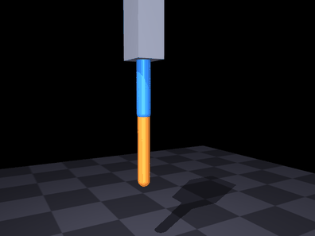
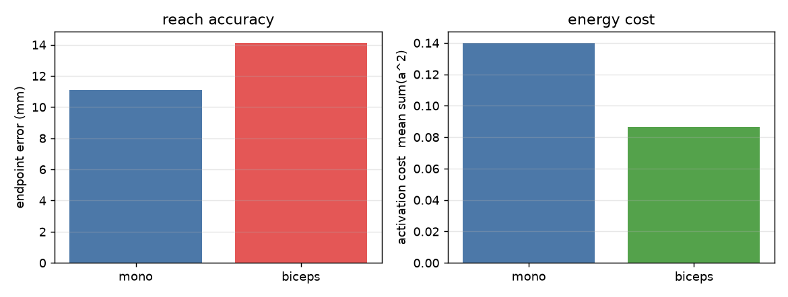
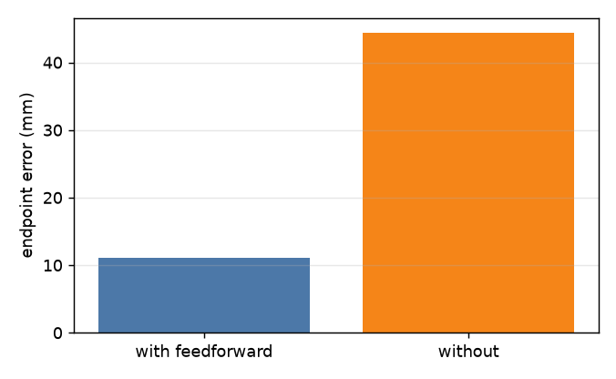
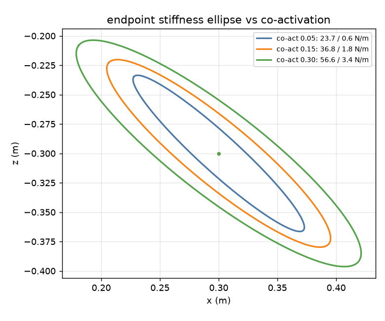
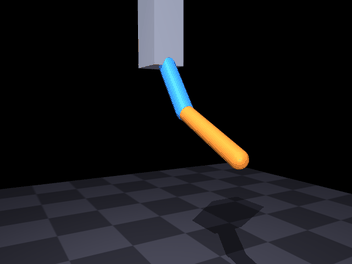
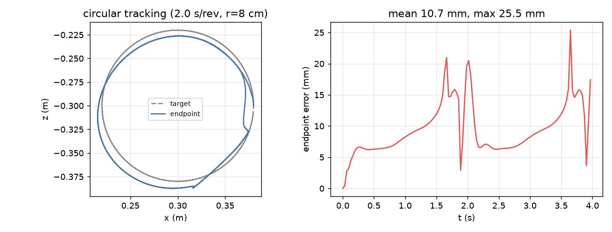

# 肌肉驱动的手臂刚度与轨迹跟踪

本页用 Hill 肌肉驱动一个肩-肘两关节平面臂，回答一个电机模型回答不了的问题：
**同一姿态下，肌肉的共激活如何改变末端的刚度？**

与仓库已有模块的关系：

| 已有模块 | 本模块的差异 |
|---|---|
| [双关节肌肉骨骼手臂到达控制](./msk_arm_reach.md) | 那个是 ROS 闭环到达（6 条肌肉、`/target_position` 接口）；本模块用 Python 实现肌肉模型、不含 ROS 节点，重点做**刚度与能耗的定量分析** |
| [肌肉驱动的关节控制](./muscle_joint_control.md) | 那个是 1 自由度；本模块是肩 + 肘双关节，且包含双关节肌 |
| [肌肉驱动的下肢关节与步态](./muscle_leg_gait.md) | 那个是下肢、要承重；本模块是上肢、无接触 |

## 1 模型与实现

### 1.1 机构

平面矢状面两连杆：上臂 0.25 m、前臂 0.25 m，肩与肘各一个铰链，末端用 site 标记。
肩角 \\\(\theta_s\\\) 从竖直向下起算（向前为正），肘角 \\\(\theta_e\\\) 为屈曲角。

$$
x = L_1\sin\theta_s + L_2\sin(\theta_s+\theta_e),\qquad
z = -L_1\cos\theta_s - L_2\cos(\theta_s+\theta_e)
$$

逆解用标准两连杆闭式解，三目标点为 \\\((0.30,-0.30)\\\)、\\\((0.15,-0.42)\\\)、\\\((0.38,-0.10)\\\)。

### 1.2 肌肉

MuJoCo 只负责刚体动力学与关节限位，**Hill 肌肉由 Python 实现**，肌力经 `qfrc_applied`
施加。这样肌肉部分完全可单元测试，也不受 MuJoCo 内置 `muscle` 执行器归一化方式影响。

肌肉长度用解析矩臂：

$$
l = L_0 - (a_s\theta_s + a_e\theta_e),\qquad \tau = A^\top F
$$

两种肌肉配置：

| 配置 | 肌肉 |
|---|---|
| 单关节版 | 肩屈 / 肩伸 / 肘屈 / 肘伸 |
| 双关节版 | 肩屈 / 肩伸 / 肘伸 / **肱二头肌** \\\((a_s>0, a_e>0)\\\) |

## 2 六组实验

### 2.1 A1 单条肌肉：模型基线

肩屈肌激活在 0.4 s 从 0.05 跳到 0.35。

| 指标 | 数值 |
|---|---|
| 峰值肩角 | **0.913 rad** |
| 终止角 | 0.627 rad |
| 峰值肌力 | **130 N** |



### 2.2 A2 到达能力：基线

PD 在关节空间跟踪逆解目标角，叠加 `qfrc_bias` 重力前馈。

| 目标 (m) | 端点误差 |
|---|---|
| (0.30, −0.30) | 10.5 mm |
| (0.15, −0.42) | 7.4 mm |
| (0.38, −0.10) | 15.5 mm |
| **平均** | **11.1 mm** |


### 2.3 A3 双关节肱二头肌：省力还是更准

把肘屈肌换成跨肩肘的肱二头肌，改用联合 QP 分配（\\\(\min \sum a^2\\\) s.t. \\\(A a=\tau\\\)）。

| 配置 | 端点误差 | 激活代价 |
|---|---|---|
| 单关节版 | 11.1 mm | 0.140 |
| 双关节版 | **14.1 mm** | **0.086** |

**双关节肌是"省力不精确"的折中**：激活代价降 38%，端点精度下降 27%。
一条肌肉同时给两个关节出力，在电机模型里没有对应物。




### 2.4 A4 重力前馈：能不能省

同样的到达任务，去掉 `qfrc_bias` 前馈：

| 配置 | 平均端点误差 |
|---|---|
| 有前馈 | **11.1 mm** |
| 无前馈 | **44.4 mm**（4 倍） |

肌肉只能拉不能推，重力造成的下垂无法靠 PD 的稳态误差补回来。



### 2.5 A5 端点刚度：共激活能改变"手有多硬"

固定姿态 \\\((0.30,-0.30)\\\)、零速度，对关节力矩求导得到关节刚度，再变换到笛卡尔空间：

$$
K_x = J^{-\top} K_q J^{-1},\qquad K_q = -\frac{\partial \tau}{\partial q}
$$

| 共激活 | 主刚度 | 次刚度 | 各向异性 |
|---|---|---|---|
| 0.05 | 23.7 N/m | 0.65 N/m | 36.5 |
| 0.15 | 36.8 N/m | 1.78 N/m | 20.6 |
| 0.30 | **56.6 N/m** | 3.35 N/m | 16.9 |

两点结论：

1. 共激活从 0.05 提到 0.30，主方向刚度涨 **2.4 倍**，而**姿势一点没变**；
2. 刚度高度各向异性（36 倍），且共激活越大各向异性越小——软方向涨得更快，椭圆变圆。

这是电机模型必须额外写阻抗控制器才能做到的事。



### 2.6 A6 圆轨迹跟踪

末端沿半径 8 cm 的圆运动，2 s 一圈，关节空间 PD + 目标速度前馈 + 重力前馈。

| 指标 | 数值 |
|---|---|
| 稳态平均误差 | **10.7 mm** |
| 稳态最大误差 | 25.5 mm |

误差随相位周期性起伏（重力方向在变），正是"肌肉只能拉不能推"的体现。





## 3 复现

```bash
cd src/musculoskeletal/mujoco_muscle_arm_stiffness
python3 main.py check                 # 模型 + IK 往返
python3 main.py bench --out out       # 复现 2.1-2.6 全部数字
python3 main.py gif --out gif         # 复现本页动图
python3 tools/plot_metrics.py out/metrics.json out   # 复现本页 4 张图
python3 -m unittest discover -s tests # 18 项
```

## 4 已知限制

1. **平面矢状面**：只建模肩屈伸与肘屈伸，没有肩外展/旋转、腕关节与手掌。
2. **解析矩臂**：真实肌肉力臂随构型变化，这里用常数矩臂。
3. **参数为缩放模型**：上臂/前臂各 0.25 m，质量 2.0/1.2 kg，不对应具体人体。
4. **A6 是关节空间 PD 跟踪逆解轨迹**，未做阻抗/自适应控制。
5. **不含 ROS 节点**：不接受外部目标话题；ROS 闭环版本见 [msk_arm_reach](./msk_arm_reach.md)。
6. 未做 sim2real。

## 5 建模陷阱（值得记录）

MuJoCo 中 `axis="0 1 0"` 的**正转方向是 −x**，与常见二维推导的 +x 相反。
若不统一关节轴与 FK/IK，目标点会被镜像，表现为"误差几百毫米但姿态看起来正常"。
本项目统一把关节轴写成 `0 -1 0`，使 \\\(\theta>0\\\) 对应 +x。

## 6 参考

* A. V. Hill, *The heat of shortening and the dynamic constants of muscle*, 1938
* F. E. Zajac, *Muscle and tendon: properties, models, scaling, and application to
  biomechanics and motor control*, 1989
